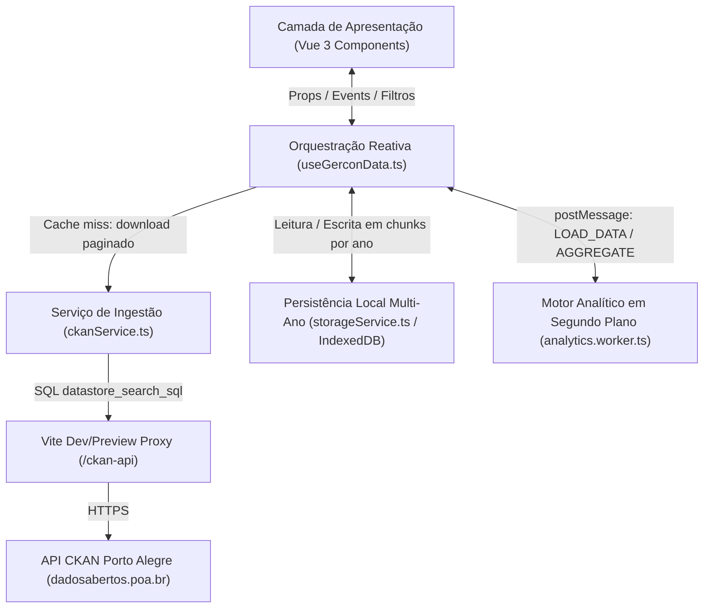
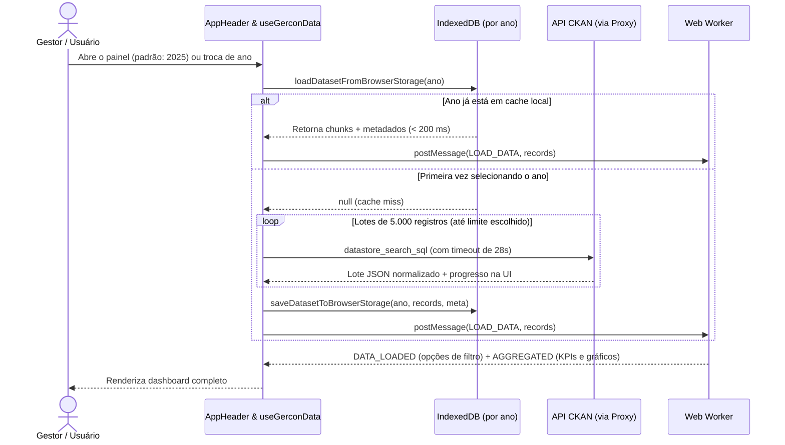

# Arquitetura e Design — Painel Analítico GERCON Porto Alegre

**Disciplina:** INF01006 — Projeto de Banco de Dados (UFRGS — Instituto de Informática)  
**Professora:** Renata de Matos Galante  
**Tema:** Visualização interativa das filas de consultas especializadas do SUS em Porto Alegre (Dados Abertos GERCON, série histórica 2017–2026)

---

## 1. Visão Geral e Motivação

O sistema **GERCON (Gerenciamento de Consultas)** da Secretaria Municipal de Saúde de Porto Alegre disponibiliza dados públicos sobre solicitações de consultas especializadas no portal **Dados Abertos de Porto Alegre** (`dadosabertos.poa.br`), baseado na plataforma **CKAN**.

### Desafios da Fonte de Dados Real
- **Alto volume anual:** apenas a base de **2025** possui mais de **1,41 milhão de registros** (e **2026** ultrapassa **1,55 milhão**), com arquivos CSV individuais na casa de centenas de megabytes.
- **Limitações da API CKAN:** consultas diretas por interação sofrem com latência variável, *rate limiting*, timeouts e ausência de cabeçalhos CORS (`Access-Control-Allow-Origin`) para consumo direto pelo navegador.
- **Heterogeneidade dos dados clínicos:** o campo real `situacaosolicitacao` contém 16 estados operacionais distintos (ex.: `AGUARDA_REGULACAO`, `AGENDA_CONFIRMADA`, `ENCAMINHADA_AO_NIR`, `CANCELADA_SEM_REVERSAO`), exigindo normalização consistente para análise gerencial.

### Estratégia Arquitetural em Duas Fases
1. **Fase 1 — Front-end Autônomo (Implementada):** aplicação SPA em **Vue 3 + TypeScript + Vite** que baixa sob demanda os dados do ano selecionado diretamente da API CKAN (via proxy de desenvolvimento), normaliza e persiste os registros por ano no **IndexedDB** do navegador, e executa todas as filtragens e agregações em segundo plano via **Web Worker**.
2. **Fase 2 — Back-end e ETL (Planejada):** substituição da camada de ingestão no cliente por um pipeline ETL assíncrono (Node.js / GitHub Actions) alimentando um banco **PostgreSQL no Supabase** com views pré-agregadas e API **PostgREST**, preservando integralmente os componentes de visualização.

---

## 2. Stack Tecnológica e Decisões de Projeto

| Camada | Tecnologia | Justificativa Arquitetural |
| :--- | :--- | :--- |
| **Interface / Estado** | Vue 3 (Composition API) | Reatividade granular e composables reutilizáveis (`useGerconData`), separando estado de domínio da camada visual. |
| **Tipagem** | TypeScript (`strict: true`) | Tipagem estrita dos payloads CKAN, registros normalizados, mensagens do Web Worker e estruturas de agregação. |
| **Build & Proxy** | Vite 6 | Empacotamento otimizado (incluindo bundle dedicado para Web Worker ES Module) e proxy `/ckan-api` para contornar restrições de CORS em desenvolvimento. |
| **Gráficos Padrão** | Chart.js 4 | Renderização em `<canvas>` de alto desempenho para barras empilhadas, séries temporais e histogramas, com tree-shaking por controlador. |
| **Visualização Customizada** | D3.js 7 | Controle preciso sobre escalas de banda, escala sequencial perceptualmente uniforme (`interpolateCividis`), acessibilidade por célula SVG e responsividade via `ResizeObserver`. |
| **Persistência Local** | IndexedDB + `localStorage` | Armazenamento estruturado multi-ano sem o limite de ~5 MB do `localStorage`, suportando dezenas de milhares de registros por ano com carregamento instantâneo. |
| **Concorrência no Cliente** | Web Workers | Garante interações e filtragens em **< 1 segundo** (tipicamente 15–80 ms) sem bloquear a thread principal de renderização. |

---

## 3. Arquitetura do Sistema

A arquitetura adota uma separação estrita em **cinco camadas desacopladas**:

### Papel de Cada Módulo
- **`src/services/ckanService.ts`**: encapsula o mapeamento oficial dos 10 recursos CKAN (`2017` a `2026`), a construção das consultas SQL, paginação em lotes de 5.000 registros, controle de timeout e normalização dos campos brutos.
- **`src/services/storageService.ts`**: gerencia o banco IndexedDB `gercon_poa_multiyear_db` com duas *object stores*:
  - `record_chunks`: armazena blocos de 2.500 registros indexados por `year` (`by_year`), permitindo ler ou invalidar um único ano sem afetar os demais.
  - `metadata`: guarda data de sincronização, escopo (`poa` ou `rs`), contagem de registros e `resourceId` por ano.
- **`src/workers/analytics.worker.ts`**: mantém o conjunto de registros do ano ativo em memória isolada e responde às mensagens `LOAD_DATA` e `AGGREGATE`.
- **`src/composables/useGerconData.ts`**: coordena o ciclo de vida (verificação de cache → download sob demanda → persistência → hidratação do Worker → debounce de filtros).
- **`src/components/*`**: componentes puramente orientados a dados já agregados, facilitando a futura migração para um back-end SQL/Supabase.

---

## 4. Fluxo de Dados, Cache Multi-Ano e Resiliência

### Mecanismos de Resiliência Implementados
1. **Seleção projetada de colunas (`SELECT` enxuto):** reduz o tamanho do payload JSON em ~65% frente ao CSV completo, acelerando o download inicial.
2. **Fallback automático de esquema:** caso algum recurso de ano mais antigo (ex.: 2017–2019) omita uma coluna opcional, `queryBatch` detecta o erro HTTP 400/409 e refaz a consulta com `SELECT *`.
3. **Timeout e *Retry* com *Backoff*:** cada lote usa `AbortController` (28 segundos) e até 2 retentativas com atraso progressivo; em caso de falha ou *rate limit* (HTTP 429), o componente `InitLoader.vue` apresenta mensagem amigável e botão de nova tentativa.
4. **Cancelamento seguro:** trocar de ano durante um download em andamento aborta automaticamente as requisições anteriores, evitando condições de corrida (*race conditions*).

---

## 5. Modelagem e Normalização de Dados

Os registros brutos da API CKAN (`RawGerconRecord`) são convertidos para o modelo canônico `GerconRecord`:

| Campo Canônico | Origem no CKAN (GERCON) | Transformação / Regra |
| :--- | :--- | :--- |
| `_id` | `_id` | Identificador numérico único. |
| `data_solicitacao` | `data_solicitacao` | Normalizado para `YYYY-MM-DD`. |
| `data_agendamento` | `datahora_consulta` | Data da consulta agendada/realizada (`YYYY-MM-DD` ou `null`). |
| `especialidade` / `especialidade_mae` | `especialidade` / `especialidademae` | Especialidade solicitada e agrupamento macro para o mapa de calor. |
| `cid` | `cid` | Código CID-10 do diagnóstico/sintoma. |
| `classificacao_risco` | `corregulador` | Traduz códigos de triagem (`VERMELHO`, `AMARELO`, `VERDE`, `AZUL`) para rótulos legíveis. |
| `municipio_residencia` | `municipio_residencia` | Município de residência do paciente. |
| `unidade_solicitante` / `unidade_executante` | `unidadesolicitante` / `unidadeexecutante` | UBS de origem e hospital/clínica executante (com marcação explícita quando ainda não alocada). |
| `status` | `situacaosolicitacao` | Consolidado em 5 categorias canônicas (tabela abaixo). |
| `dias_espera` | `datahora_consulta - data_solicitacao` ou `diasfilaespera` | Diferença em dias (validada no intervalo `0..3650`), priorizando datas reais quando presentes. |

### Consolidação de Status da Fila
- **Atendido:** `REALIZADA`, `ENCERRADA`
- **Agendado:** `AGENDADA`, `AGENDA_CONFIRMADA`
- **Aguardando:** `AUTORIZADA`, `AUTORIZACAO_AUTOMATICA`, `AGUARDA_REGULACAO`, `PENDENTE`, `AGUARDA_MATRICIAMENTO`, `EM_MATRICIAMENTO`, `ENCAMINHADA_AO_NIR`
- **Cancelado:** `CANCELADA`, `CANCELADA_SEM_REVERSAO`, `CONFIRMACAO_EXPIRADA`
- **Devolvido:** `AGUARDA_REAVALIACAO`, `AGUARDA_REVERSAO`

### Contrato inicial do PostgreSQL para o ETL

A migração inicial em `supabase/migrations/20261122184000_create_solicitacoes.sql`
cria a tabela `public.solicitacoes`, com chave composta
`(ano_recurso, idsolicitacao)`. Os recursos CKAN de 2017–2026 consultados têm
`idsolicitacao` preenchido e único dentro de cada ano; a unicidade entre versões
futuras ainda precisa ser validada. O contrato de colunas, normalização e carga
idempotente está descrito em [Contrato inicial do banco e do ETL](./contrato-banco-etl.md).

---

## 6. Desempenho e Motor de Agregação (`analytics.worker.ts`)

Para cumprir o requisito não funcional de **atualizações em menos de 1 segundo**, o Web Worker adota:
- **Varredura única (*single-pass aggregation*):** ao receber um novo conjunto de filtros, o worker percorre `cachedRecords` **uma única vez**, acumulando simultaneamente os contadores de KPIs, matriz de status por unidade, séries temporais (total e top 5 especialidades), células do mapa de calor e lista de tempos de espera.
- **Quantis exatos:** ordena o vetor de tempos de espera para calcular **Mediana (P50)**, **P90**, **P95**, **Média** e **Máximo**, evitando distorções causadas apenas pela média aritmética.
- **Debounce de 40 ms** na reatividade dos filtros (`useGerconData.ts`), agrupando cliques rápidos em uma única mensagem ao worker.
- **Telemetria visível:** o tempo real de processamento em milissegundos (`computeTimeMs`) é exibido diretamente na barra de filtros.

---

## 7. Design das Visualizações e Casos de Uso Analíticos

O painel traduz os quatro casos de uso definidos na especificação em visualizações complementares:

1. **Indicadores Executivos (`KpiCards.vue`):** resumo imediato de volume filtrado, fila pendente, taxa de atendimento, agendamentos e mediana/P90 de espera.
2. **Proporção de Status por Unidade Prestadora (`StatusByUnitChart.vue` — Chart.js):**
   - *Objetivo:* permitir que coordenadores de triagem identifiquem gargalos sistêmicos por hospital/clínica.
   - *Recursos:* barras horizontais empilhadas com alternância entre **valores absolutos** e **proporção (100%)**, além de seletor **Top 10 / Top 15**.
3. **Tendências de Demanda Longitudinal (`DemandTimeSeriesChart.vue` — Chart.js):**
   - *Objetivo:* apoiar analistas de saúde pública no planejamento de recursos e detecção de sazonalidade.
   - *Recursos:* gráfico de linhas com alternância de granularidade **Mensal / Semanal** (semanas ISO) e modo **Top 5 Especialidades** vs. **Total Geral**.
4. **Mapa de Calor — Pressão Operacional (`OperationalHeatmap.vue` — D3.js):**
   - *Objetivo:* destacar rapidamente onde se concentra o maior volume de consultas **aguardando contemplação**.
   - *Recursos:* matriz interativa cruzando unidades com **Especialidade**, **Classificação de Risco** ou **Mês**, com destaque de leitura ao passar o mouse ou navegar por teclado e legenda contínua.
5. **Histograma de Tempo de Espera (`WaitTimeHistogramChart.vue` — Chart.js):**
   - *Objetivo:* revelar a cauda longa dos tempos de espera em vez de depender apenas de médias.
   - *Recursos:* 8 faixas pré-definidas (`0–7d`, `8–15d`, `16–30d`, `31–60d`, `61–90d`, `91–180d`, `181–365d`, `> 365d`), faixa de estatísticas (Mediana, Média, P90, P95, Máximo) e alternância entre **Consultas Atendidas** e **Todas com Espera**.

---

## 8. Acessibilidade e Design Inclusivo

- **Paletas seguras para daltônicos:**
  - Categorias de status e séries múltiplas usam a paleta **Okabe-Ito** (`#0072B2`, `#009E73`, `#E69F00`, `#D55E00`, `#CC79A7`), distinguível em protanopia, deuteranopia e tritanopia.
  - O mapa de calor usa a escala sequencial **D3 Cividis**, projetada especificamente para percepção uniforme sob deficiência de visão de cores, com contraste automático de texto (claro/escuro) dentro das células.
- **Suporte a leitores de tela e VoiceOver móvel:**
  - Todos os gráficos possuem `role="img"` e `aria-label` dinâmicos descrevendo os principais números do recorte atual.
  - Cada visualização inclui o componente **`AccessibleDataTable.vue`**, que mantém uma tabela HTML semântica disponível para leitores de tela (e expansível visualmente com um clique).
  - Navegação completa por teclado (`skip-link`, `:focus-visible` de alto contraste, células do mapa de calor focáveis via `tabindex="0"` e regiões `aria-live="polite"`).

---

## 9. Caminho de Evolução para o Back-end (Supabase + ETL)

Como o front-end já separa **aquisição de dados** (`services/`), **agregação** (`workers/`), **estado** (`composables/`) e **apresentação** (`components/`), a integração futura com o back-end proposto no artigo exige apenas:
1. Criar o worker ETL (Node.js + GitHub Actions) para sincronizar diariamente os CSVs/CKAN no PostgreSQL do Supabase.
2. Criar *views* ou funções RPC no PostgreSQL retornando exatamente os contratos TypeScript já definidos em `AggregatedDashboardData` (`src/types/gercon.ts`).
3. Trocar a chamada `requestAggregation()` em `useGerconData.ts` por chamadas à API PostgREST do Supabase — **zero alterações necessárias** nos gráficos Chart.js/D3.js ou na barra de filtros.

---

## 10. Roteiro Sugerido para Apresentação em Aula (6–8 minutos)

1. **Contexto e Problema (1 min):** Apresentar o portal Dados Abertos de Porto Alegre (GERCON), o volume de ~1,4M de linhas/ano e os desafios da API CKAN (latência, CORS, 16 status brutos).
2. **Arquitetura em Camadas (1,5 min):** Mostrar o diagrama da Seção 3 explicando Vue 3 + TypeScript + Proxy Vite + IndexedDB multi-ano + Web Worker, e como isso prepara o terreno para o Supabase na Fase 2.
3. **Demonstração ao Vivo (3 min):**
   - Abrir a aplicação com o ano **2025** carregando do cache local (destacar o badge `Cache local` e o tempo `< 100 ms`).
   - Aplicar filtros (ex.: especialidade + período + status) mostrando o contador `Atualizado em X ms` do Web Worker.
   - Alternar controles interativos: *Absoluto vs. Proporção (%)*, *Mensal vs. Semanal*, dimensões do *Mapa de Calor D3* e *Histograma* (comparando Mediana vs. Média e P90).
   - Trocar para outro ano no seletor do cabeçalho (ex.: **2024**) mostrando o download sob demanda com barra de progresso e, em seguida, voltar para **2025** instantaneamente via IndexedDB (`✓ em cache`).
4. **Acessibilidade e Decisões de Engenharia (1 min):** Destacar a paleta Okabe-Ito/Cividis e abrir uma *Tabela Acessível (VoiceOver)* abaixo de um gráfico.
5. **Próximos Passos (0,5 min):** Pipeline ETL agendado + PostgreSQL/Supabase com views materializadas mantendo o mesmo contrato de tipos do front-end.
